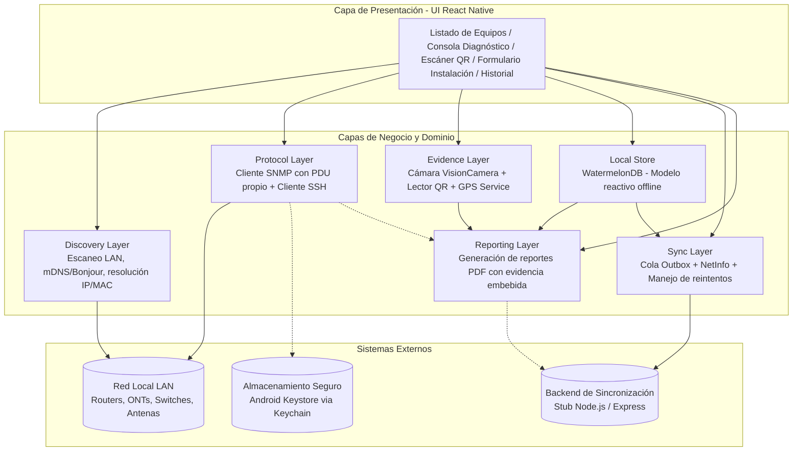
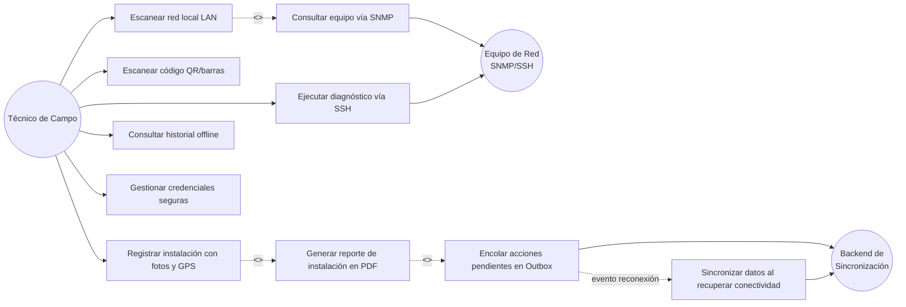
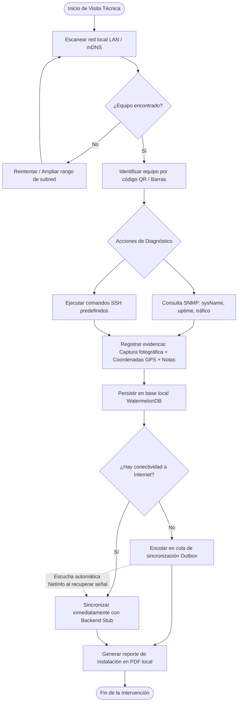

# Product Requirements Document (PRD)
## Network Diagnostics Suite — Mobile Field Toolkit

---

## 1. Información General y Metadatos del Proyecto

* **Nombre del Producto:** Network Diagnostics Suite
* **Tipo de Aplicación:** Herramienta móvil para técnicos de telecomunicaciones en campo
* **Institución Académica:** Licenciatura en Sistemas de Información — Desarrollo de Aplicaciones Móviles (2026)
* **Facultad / Sede:** FCyT — Sede Concepción del Uruguay
* **Área Temática:** Comunicaciones y Redes de Datos
* **Tecnología Base:** React Native (Bare Workflow / TypeScript)
* **Entorno de Ejecución:** Android APK nativo (incompatible con Expo Go debido a sockets crudos TCP/UDP y librerías nativas C++/NDK)
* **Paradigma Operativo:** Offline-First nativo con persistencia reactiva y patrón Outbox

---

## 2. Visión del Producto y Contexto Operativo

### 2.1 Contexto de Uso
La aplicación está concebida como un instrumento de trabajo diario para técnicos que instalan, diagnostican y mantienen equipamiento de red (ONTs de fibra óptica, routers, switches y antenas punto a punto) en condiciones físicas exigentes:
* Sitios remotos y gabinetes en vía pública sin cobertura celular o con enlace degradado.
* Azoteas y salas de comunicaciones donde la conectividad a internet es nula y solo se cuenta con acceso a la red local (LAN) provista por el equipo a relevar.

### 2.2 Desafío Tecnológico Principal
A diferencia de aplicaciones móviles convencionales basadas en HTTP/REST:
1. **Acceso a bajo nivel:** Requiere interacción directa sobre sockets TCP/UDP para descubrir equipos y enviar datagramas binarios.
2. **Implementación de protocolo propio:** Construcción y decodificación manual de tramas SNMP v1/v2c codificadas en BER/ASN.1 sobre el puerto UDP/161.
3. **Resiliencia de datos:** Todas las operaciones de diagnóstico, captura de fotos, geolocalización y generación de reportes deben completarse sin conexión a internet y sincronizarse de manera asíncrona y transaccional cuando la conectividad se restablezca.

---

## 3. Objetivos de Ingeniería

### 3.1 Objetivo General
Desarrollar una suite móvil integral para técnicos de telecomunicaciones que permita descubrir dispositivos activos en la LAN, diagnosticar su estado mediante protocolos de gestión de red (SNMP y SSH), registrar evidencia georreferenciada y generar reportes de instalación bajo un paradigma estrictamente offline-first con sincronización diferida.

### 3.2 Objetivos Específicos
1. Implementar mecanismos de descubrimiento de red mediante mDNS/Bonjour y barridos de subred orientados a ARP/sockets.
2. Desarrollar un cliente y parser SNMP v1/v2c ligero en TypeScript/JavaScript para consultar OIDs básicos de MIB-II (`sysUpTime`, `sysName`, tráfico de interfaces) sobre datagramas UDP.
3. Integrar un cliente SSH embebido capaz de autenticarse de manera segura y ejecutar secuencias de diagnóstico automatizadas según el fabricante del equipo.
4. Gestionar credenciales de acceso (claves SSH, community strings) protegiéndolas mediante el Keystore de Android mediante almacenamiento seguro.
5. Capturar códigos QR/barras de equipos para vinculación automática con fichas de inventario.
6. Capturar evidencia multimedia (fotografías) georreferenciadas con GPS y persistir las coordenadas en el informe de instalación.
7. Generar documentos PDF profesionales directamente en el almacenamiento local del dispositivo a partir de los datos relevados.
8. Diseñar una cola de sincronización transaccional (Outbox Pattern) sobre WatermelonDB que garantice la entrega eventual hacia un backend stub sin pérdida de datos.

---

## 4. Requisitos Funcionales (RF)

| ID | Módulo / Capa | Requisito Funcional | Prioridad | Criterio de Aceptación (Gherkin / Reglas) |
| :--- | :--- | :--- | :--- | :--- |
| **RF-01** | Discovery | **Escaneo de Red Local:** Descubrir dispositivos activos en el segmento LAN listando dirección IP, dirección MAC y hostname (si está disponible). | **Alta** | **Given** el dispositivo conectado a una red Wi-Fi LAN, **When** el técnico pulsa "Escanear Red", **Then** la app emite consultas mDNS y barrido de subred mostrando una lista en tiempo real de nodos detectados con IP, MAC y estado. |
| **RF-02** | Protocol (SNMP) | **Consulta de Métricas SNMP:** Consultar en el dispositivo objetivo: `uptime`, `sysName` y tráfico de interfaces de red mediante datagramas UDP al puerto 161. | **Alta** | **Given** una IP activa y una community string válida, **When** se ejecuta el diagnóstico SNMP, **Then** la app envía un paquete binario `GetRequest`, decodifica la respuesta `GetResponse` (BER/ASN.1) y muestra las métricas de MIB-II formateadas en pantalla. |
| **RF-03** | Protocol (SSH) | **Diagnóstico Remoto SSH:** Establecer sesión SSH con el equipo de red y ejecutar un lote predeterminado de comandos técnicos (`show interfaces`, `uptime`, etc.). | **Alta** | **Given** credenciales SSH válidas y un puerto TCP abierto, **When** se inicia el test SSH, **Then** la app abre la sesión, ejecuta los comandos sin interacción manual y muestra la salida en una consola embebida. |
| **RF-04** | Evidence (Barcode) | **Identificación de Equipos:** Escanear códigos QR o de barras adheridos al chasis del equipo para recuperar o asociar su número de serie / ficha técnica. | **Media** | **Given** la cámara activa en modo scanner, **When** se enfoca un código QR/barra, **Then** la app decodifica el valor alfanumérico y autocompleta el identificador de equipo en el formulario de instalación. |
| **RF-05** | Evidence (Media & GPS) | **Registro de Instalación Georreferenciada:** Registrar una intervención técnica adjuntando fotografías, coordenadas GPS precisas y notas técnicas. | **Alta** | **Given** una orden de trabajo abierta, **When** el técnico toma una fotografía, **Then** la app obtiene las coordenadas satelitales (lat/long/altitud), las vincula a la imagen y almacena el registro en la base local. |
| **RF-06** | Reporting | **Generación de Reporte PDF:** Consolidar métricas, notas, fotos y geolocalización en un documento PDF exportable localmente. | **Media** | **Given** una instalación finalizada con evidencia, **When** se selecciona "Generar Reporte", **Then** se compila un PDF maquetado con encabezado institucional, datos de red, mapa/coordenadas y fotografías adjuntas. |
| **RF-07** | Sync (Outbox) | **Operación Offline y Encolado:** Funcionar íntegramente sin internet y derivar las transacciones a una cola Outbox para su sincronización diferida. | **Alta** | **Given** el dispositivo en modo avión o sin salida a internet, **When** se confirma un diagnóstico o instalación, **Then** el payload se guarda localmente con estado `PENDING` y se dispara automáticamente hacia el backend stub apenas NetInfo detecte conectividad. |
| **RF-08** | Local Store | **Historial Técnico Offline:** Consultar intervenciones, métricas históricas y diagnósticos previos sin requerir conectividad externa. | **Media** | **Given** la aplicación sin conexión, **When** el técnico accede a la sección de historial o detalle de equipo, **Then** la app recupera reactivamente los registros cacheados en WatermelonDB. |

---

## 5. Requisitos No Funcionales (RNF)

### 5.1 Seguridad y Privacidad (OWASP Mobile Application Security)
* **RNF-01 (Manejo Seguro de Credenciales):** Las contraseñas SSH, claves privadas y *community strings* SNMP no deben almacenarse en texto plano, bases SQLite ni `AsyncStorage`. Deben residir en el hardware de seguridad nativo (Android Keystore / iOS Keychain) mediante `react-native-keychain`.
* **RNF-02 (Aislamiento de Logs):** Queda prohibida la impresión por consola (`console.log`) de contraseñas, tokens de autenticación o tramas de red con credenciales visibles.
* **RNF-03 (Almacenamiento Local de Evidencia):** Las fotografías capturadas deben almacenarse en el directorio seguro interno de la aplicación (`application support/cache`), evitando exponerlas a la galería pública sin autorización.

### 5.2 Desempeño y Concurrencia
* **RNF-04 (Manejo de Sockets No Bloqueante):** Las operaciones de barrido de puertos/subred y las transacciones UDP SNMP deben manejarse de forma asíncrona mediante workers o callbacks para evitar bloqueos del hilo principal de renderizado (UI Thread).
* **RNF-05 (Timeouts Determinísticos):** Toda petición de red por socket (TCP o UDP) debe implementar un timeout estricto (e.g., 2000 ms para SNMP, 5000 ms para SSH) para evitar fugas de memoria o estados colgados ante equipos que no respondan.

### 5.3 Resiliencia y Disponibilidad
* **RNF-06 (Persistencia Reactiva):** La capa de datos debe utilizar WatermelonDB con arquitectura basada en SQLite nativo, garantizando tiempos de lectura inferiores a 16 ms en listas de más de 500 registros.
* **RNF-07 (Reintentos con Backoff Exponencial):** La cola Outbox debe reintentar envíos fallidos al recuperar la conexión aplicando un algoritmo de retroceso exponencial con límite máximo de reintentos para no agotar la batería ni saturar el canal de radio.

### 5.4 Compatibilidad de Plataforma
* **RNF-08 (Compatibilidad de SO):** Soporte garantizado para Android 8.0 (API Level 26) o superior. 
* **RNF-09 (Generación de APK Standalone):** El proyecto debe compilarse directamente como un APK de prueba mediante Gradle (`./gradlew assembleRelease` / `assembleDebug`).

---

## 6. Arquitectura del Sistema

### 6.1 Arquitectura en Capas
La aplicación divide sus responsabilidades en seis capas de dominio y soporte técnico, desacopladas de la capa de presentación:



### 6.2 Relaciones de Casos de Uso
El técnico de campo orquesta las acciones principales. El sistema impone dependencias operativas automáticas mediante inclusiones (`<<include>>`):



### 6.3 Diagrama de Flujo: Ciclo de Diagnóstico e Instalación
Secuencia de ejecución completa durante una intervención técnica en campo:



---

## 7. Especificación Técnica de Protocolos de Red (Bajo Nivel)

### 7.1 Protocolo SNMP v1/v2c (Implementación Ligera de Parser BER/ASN.1)
Dado que React Native no dispone de librerías puras maduras para SNMP en sockets nativos, la aplicación incorpora un módulo propio para codificar y decodificar datagramas SNMP:

* **Capa de Transporte:** UDP crudo mediante `react-native-udp` vinculado al puerto de destino 161.
* **Versión del Protocolo:** SNMPv1 / SNMPv2c basado en *community strings* (e.g. `public`). Queda excluido SNMPv3 (USM) por restricciones de alcance.
* **Operación Implementada:** `GetRequest` (PDU Type `0xA0`) y lectura de `GetResponse` (PDU Type `0xA2`).
* **Codificación:** Basic Encoding Rules (BER) de ASN.1:
  * Sequence: `0x30`
  * Integer: `0x02`
  * Octet String: `0x04`
  * Null: `0x05`
  * Object Identifier (OID): `0x06`
* **OIDs MIB-II Soportados:**
  * `1.3.6.1.2.1.1.1.0` — `sysDescr` (Descripción general del equipo)
  * `1.3.6.1.2.1.1.3.0` — `sysUpTime` (Tiempo de actividad desde el encendido)
  * `1.3.6.1.2.1.1.5.0` — `sysName` (Nombre del sistema asignado)
  * `1.3.6.1.2.1.2.2.1.10.x` — `ifInOctets` (Bytes entrantes por interfaz)
  * `1.3.6.1.2.1.2.2.1.16.x` — `ifOutOctets` (Bytes salientes por interfaz)

### 7.2 Acceso Remoto SSH
* **Librería Base:** `react-native-ssh-sftp` o bridge nativo compatible.
* **Flujo de Ejecución:**
  1. Recuperación de credenciales (host, port 22, user, pass/key) desde `react-native-keychain`.
  2. Apertura del canal shell/exec.
  3. Ejecución de lote de comandos seguros en modo no interactivo:
     * MikroTik RouterOS: `/system resource print`, `/interface print`
     * Cisco IOS / EdgeOS: `show version`, `show ip interface brief`
     * Linux / BusyBox ONTs: `cat /proc/uptime`, `ifconfig`
  4. Cierre inmediato de la sesión y parseo del buffer de texto a la consola de UI.

---

## 8. Persistencia y Arquitectura Offline-First (WatermelonDB)

### 8.1 Esquema de Base de Datos Local
Se define un esquema relacional adaptado a WatermelonDB con sincronización por estados:

```typescript
// Tablas de la base de datos local
// 1. devices
//    - id (string, uuid)
//    - ip_address (string)
//    - mac_address (string)
//    - hostname (string, optional)
//    - vendor (string, optional)
//    - serial_number (string, optional)
//    - created_at (number)
//    - updated_at (number)

// 2. diagnostics
//    - id (string, uuid)
//    - device_id (string, foreign key)
//    - protocol (string: 'SNMP' | 'SSH')
//    - raw_output (string)
//    - parsed_metrics (json string: uptime, sysName, etc.)
//    - status (string: 'SUCCESS' | 'FAILED')
//    - executed_at (number)

// 3. installations
//    - id (string, uuid)
//    - device_id (string, foreign key)
//    - technician_notes (string)
//    - latitude (number)
//    - longitude (number)
//    - photo_uri (string)
//    - pdf_path (string, optional)
//    - created_at (number)

// 4. outbox_queue
//    - id (string, uuid)
//    - entity_type (string: 'INSTALLATION' | 'DIAGNOSTIC')
//    - entity_id (string)
//    - payload (string, json serializado)
//    - attempts (number)
//    - last_error (string, optional)
//    - status (string: 'PENDING' | 'SYNCING' | 'FAILED')
//    - created_at (number)
//    - updated_at (number)
```

### 8.2 Patrón Outbox y Manejo de Conectividad
1. **Escucha Continua:** `@react-native-community/netinfo` suscribe un listener de conectividad.
2. **Disparo de Sincronización:** Cuando `isConnected === true` y `isInternetReachable === true`, el servicio `OutboxSyncService` toma los registros con estado `PENDING` de la tabla `outbox_queue`.
3. **Idempotencia:** Cada transacción enviada incluye su propio `id` (UUIDv4) para evitar duplicados en el backend ante fallos de ACK.
4. **Manejo de Errores:** Si el backend responde con error 5xx o timeout, se incrementa `attempts` y se reprograma con backoff. Si responde 200/201, se elimina o marca como `SYNCED`.

---

## 9. Evidencia, Captura y Reportes PDF

### 9.1 Captura de Códigos y Fotografías
* **Módulo de Cámara:** `react-native-vision-camera`.
* **Escaneo de Códigos:** Integración con escáner de códigos de barras (QR, Code 128, EAN-13) para recuperar el número de serie de la etiqueta del equipo.
* **Captura de Fotos:** Disparo fotográfico en alta resolución almacenado en el sandbox privado de la app.

### 9.2 Geolocalización Satelital
* **Librería:** `react-native-geolocation-service`.
* **Configuración:** Modo de alta precisión (`enableHighAccuracy: true`), timeout de 10000 ms y `maximumAge: 5000` ms para capturar coordenadas reales en el sitio de instalación.

### 9.3 Compilación de Reportes PDF
* **Librería:** `react-native-html-to-pdf`.
* **Estructura del Documento:**
  1. Cabecera institucional con datos de la intervención y fecha/hora.
  2. Ficha del equipo (IP, MAC, Serial obtenido por QR, fabricante).
  3. Diagnósticos ejecutados (Uptime, estado de interfaces, logs SSH resumidos).
  4. Coordenadas de georreferenciación (Latitud, Longitud, enlace o mapa visual).
  5. Evidencia fotográfica embebida en base64 o referencia local.
  6. Firma digital o conformidad del técnico.

---

## 10. Backend Stub de Sincronización

Para validar el flujo end-to-end de la cola offline, se debe disponer de un micro-backend ligero en Node.js/Express (ubicado en `/backend-stub`):

* **POST `/api/v1/sync/installations`:** Recibe el payload completo de una instalación (metadatos, coordenadas, notas e imagen en base64 o multipart).
* **POST `/api/v1/sync/diagnostics`:** Recibe registros históricos de pruebas SNMP y SSH.
* **GET `/api/v1/health`:** Permite al cliente validar si la conectividad a internet efectivamente alcanza el servidor.

---

## 11. Entregables y Criterios de Aceptación del Trabajo Práctico

1. **Repositorio Git:** Código fuente completo, modularizado en capas limpias y tipado con TypeScript.
2. **Build de Prueba (APK):** Archivo `.apk` compilado para pruebas en dispositivos físicos Android.
3. **Documento Técnico de Diseño (`docs/TECHNICAL_DESIGN.md`):** Explicación formal del subset SNMP implementado, arquitectura del parser BER/ASN.1, esquema de seguridad de credenciales y ciclo de vida de la cola outbox.
4. **Backend Stub:** Servidor local ejecutable con un comando (`npm run start:stub`) para comprobar la recepción de datos.
5. **Video Demostrativo:** Registro audiovisual que muestre:
   * Escaneo y descubrimiento de un dispositivo real en la red LAN.
   * Consulta SNMP exitosa con visualización de métricas.
   * Registro de una instalación (QR + foto + GPS).
   * Generación del PDF local.
   * Encolado offline y sincronización efectiva al encender la conexión.