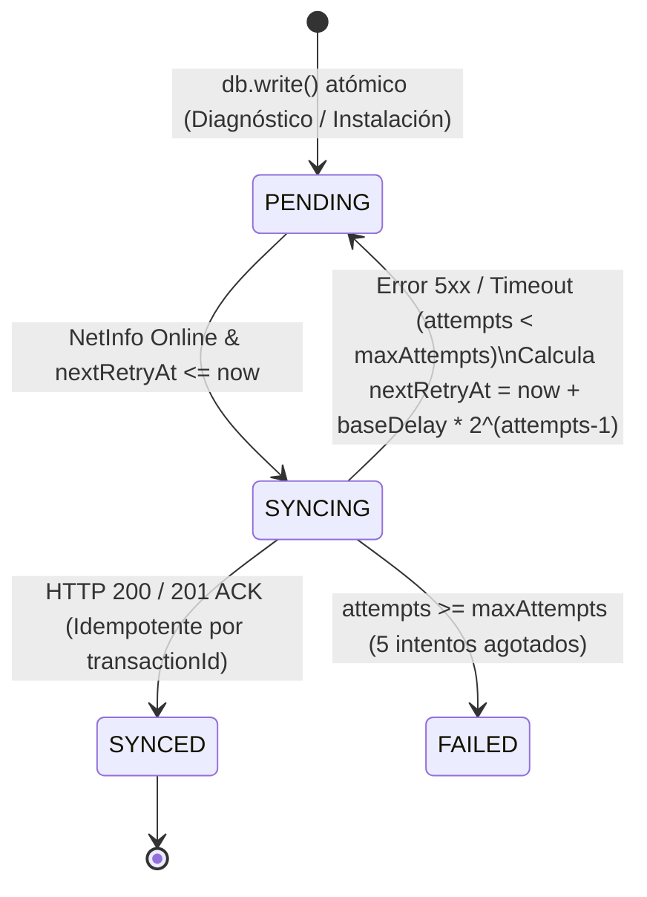

# Documento Técnico de Diseño (`TECHNICAL_DESIGN.md`)
## Network Diagnostics Suite — Mobile Field Toolkit

---

## 1. Arquitectura Limpia en 6 Capas

La aplicación está estructurada bajo seis capas de dominio desacopladas de la capa de presentación React Native (`src/screens/`):

1. **Discovery Layer (`src/layers/discovery/`):** Escaneo de segmento LAN `/24` mediante ráfagas asíncronas no bloqueantes (**RNF-04**), descubrimiento mDNS/Bonjour (`react-native-zeroconf`) y resolución offline de fabricante por prefijo OUI de dirección MAC.
2. **Protocol Layer (`src/layers/protocol/`):**
   * **SNMP (`src/layers/protocol/snmp/`):** Codec binario BER/ASN.1 propio y cliente UDP (`react-native-udp`) sobre el puerto `161` con timeout determinístico de `2000 ms` (**RNF-05**).
   * **SSH (`src/layers/protocol/ssh/`):** Cliente SSH con perfiles de comandos no interactivos por fabricante (MikroTik RouterOS, Cisco IOS / EdgeOS, Linux / BusyBox ONT) y timeout estricto de `5000 ms` (**RNF-05**).
3. **Evidence Layer (`src/layers/evidence/`):** Decodificador de etiquetas QR/Code-128/EAN-13 (`react-native-vision-camera`), captura fotográfica confinada al sandbox privado interno de la aplicación (**RNF-03**) y geolocalización satelital de alta precisión (`react-native-geolocation-service`, `enableHighAccuracy: true`, `timeout: 10000 ms`, `maximumAge: 5000 ms`).
4. **Local Store Layer (`src/layers/store/`):** Persistencia reactiva offline-first sobre **WatermelonDB** (`SQLiteAdapter` con `jsi: true`) compuesta por las tablas `devices`, `diagnostics`, `installations` y `outbox_queue` (**RNF-06**).
5. **Sync Layer (`src/layers/sync/`):** Implementación del patrón **Transactional Outbox** con escucha continua de `@react-native-community/netinfo`, control de idempotencia por `transactionId` (UUIDv4) y reintentos con *exponential backoff* (**RNF-07**).
6. **Reporting Layer (`src/layers/reporting/`):** Compilador de informes técnicos en formato PDF (`react-native-html-to-pdf`) con maquetación institucional de 6 secciones y sanitización HTML.

---

## 2. Especificación del Subset SNMP v1/v2c y Arquitectura del Parser BER/ASN.1

### 2.1 Estructura de Trama SNMP (`GetRequest` / `GetResponse`)
Cada mensaje SNMP v1 (`0x00`) o v2c (`0x01`) se transporta en un único datagrama UDP hacia el puerto `161` como una estructura `SEQUENCE (0x30)` de tres elementos:

```text
SEQUENCE (0x30)
 ├── version: INTEGER (0x02) -> 0 (v1) | 1 (v2c)
 ├── community: OCTET STRING (0x04) -> Redactado en logs/memoria tras decodificar (RNF-02)
 └── data: GetRequest-PDU (0xA0) | GetResponse-PDU (0xA2)
      ├── request-id: INTEGER (0x02) -> Identificador aleatorio de 31 bits para correlación
      ├── error-status: INTEGER (0x02) -> 0 (noError)
      ├── error-index: INTEGER (0x02) -> 0
      └── variable-bindings: SEQUENCE OF (0x30)
           └── VarBind: SEQUENCE (0x30)
                ├── name: OBJECT IDENTIFIER (0x06)
                └── value: NULL (0x05 en GetRequest) | Valor tipado en GetResponse
```

### 2.2 Reglas de Codificación BER (Basic Encoding Rules) Implementadas
El módulo `src/layers/protocol/snmp/berCodec.ts` opera directamente sobre arreglos tipados `Uint8Array`:

* **Longitudes Determinadas (`encodeBerLength` / `decodeBerLength`):**
  * *Forma corta (`0..127` bytes):* Un único octeto con el bit más significativo en `0`.
  * *Forma larga (`> 127` bytes):* Octeto inicial `0x80 | numOctets` seguido de `numOctets` bytes en orden *big-endian*.
* **Enteros con Signo (`0x02`):** Codificación en complemento a 2 con inserción automática de byte de relleno `0x00` cuando el bit más significativo de un entero positivo es `1`.
* **Contadores y Métricas Sin Signo (`Counter32 0x41`, `Gauge32 0x42`, `TimeTicks 0x43`, `Counter64 0x46`):** Decodificación acumulada sin signo para evitar desbordamientos de signo en operadores bitwise de 32 bits en JavaScript.
* **Object Identifier (`OID 0x06`):**
  * Los dos primeros arcos (`X.Y`) se comprimen en el primer octeto mediante la fórmula `40 * X + Y` (e.g., `1.3` $\rightarrow$ `43` = `0x2B`).
  * Cada sub-identificador subsecuente se codifica en base 128 (*Variable-Length Quantity*), activando el bit `7` (`0x80`) en todos los octetos excepto el último del sub-identificador.

### 2.3 OIDs MIB-II Soportados
| OID | Nombre MIB-II | Tipo ASN.1 Esperado | Uso en Diagnóstico |
| :--- | :--- | :--- | :--- |
| `1.3.6.1.2.1.1.1.0` | `sysDescr` | `OCTET_STRING (0x04)` | Plataforma / versión de firmware del equipo |
| `1.3.6.1.2.1.1.3.0` | `sysUpTime` | `TIMETICKS (0x43)` | Tiempo de actividad en centésimas de segundo |
| `1.3.6.1.2.1.1.5.0` | `sysName` | `OCTET_STRING (0x04)` | Hostname administrativo configurado |
| `1.3.6.1.2.1.2.2.1.10.x` | `ifInOctets.x` | `COUNTER32 (0x41)` | Tráfico entrante acumulado en interfaz `x` |
| `1.3.6.1.2.1.2.2.1.16.x` | `ifOutOctets.x` | `COUNTER32 (0x41)` | Tráfico saliente acumulado en interfaz `x` |

---

## 3. Esquema de Seguridad de Credenciales y Evidencia (OWASP MASVS)

1. **Almacenamiento en Hardware/Keystore (`RNF-01`):**
   * `CredentialStore` (`src/shared/security/credentialStore.ts`) utiliza `react-native-keychain` con política `ACCESSIBLE.WHEN_UNLOCKED_THIS_DEVICE_ONLY` y `SECURITY_LEVEL.SECURE_SOFTWARE`.
   * Las contraseñas SSH, claves privadas y *community strings* SNMP jamás se escriben en las tablas de WatermelonDB ni en `AsyncStorage`.
2. **Aislamiento de Logs y Tramas (`RNF-02`):**
   * El socket UDP de `SnmpClient` se instancia con `debug: false`.
   * `decodeSnmpGetResponse` valida el campo `community` de la trama binaria pero lo descarta inmediatamente; `formatRedactedSnmpSummary` imprime explícitamente `community=***REDACTED***`.
   * La interfaz gráfica consume únicamente `StoredCredentialMetadata` (indicadores booleanos de presencia de secretos).
3. **Confinamiento de Fotografías en Sandbox (`RNF-03`):**
   * `ensurePrivateSandboxUri` verifica que toda captura fotográfica provenga del directorio interno privado (`/data/user/0/com.networkdiagnosticsapp/...`) y bloquea cualquier ruta que apunte a `/storage/emulated/0/DCIM` o `Pictures`.

---

## 4. Ciclo de Vida de la Cola Transaccional Outbox



1. **Encolado Transaccional (`FieldOperationsRepository`):** Cuando el técnico confirma un diagnóstico o una instalación, la entidad de dominio (`diagnostics` o `installations`) y su registro en `outbox_queue` se insertan dentro del mismo bloque `db.write()` de WatermelonDB, garantizando atomicidad aún ante cierres abruptos de la app.
2. **Idempotencia Extremo a Extremo:** Cada payload encolado incluye un `transactionId` UUIDv4 generado en el cliente. El servidor `backend-stub` mantiene un conjunto `processedTransactions` que responde `200 OK (duplicate: true)` si una misma transacción es retransmitida por caída del enlace durante el ACK.
3. **Backoff Exponencial (`RNF-07`):** Ante errores de red o respuestas HTTP no exitosas, `OutboxQueueItem.registerFailure` incrementa `attempts` y programa `next_retry_at = Date.now() + 2000 * 2^(attempts - 1)`. Al alcanzar `max_attempts = 5`, el registro pasa a estado `FAILED` para evitar drenaje de batería en campo.
